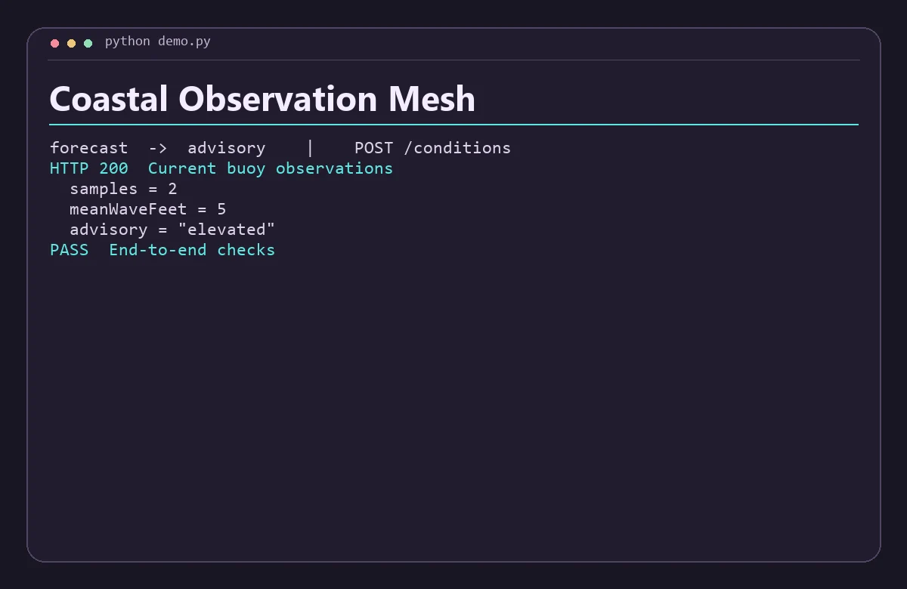

# Coastal Observation Mesh

Combine recent buoy readings into a beach conditions summary, with a separate advisory service and stale-data handling.



## Run the demo

Install Python 3.11+, Node.js 22+, then run this from the repository root.

```sh
python demo.py
```

The command starts both services on separate loopback ports, sends the requests in `examples.json`, checks the responses, and shuts down the processes. Use `python3` if that is how your system exposes Python.

## Run the services with Docker Compose

```sh
docker compose up -d --build
python demo.py --base-url http://127.0.0.1:8080
docker compose down
```

The API binds to loopback on port 8080 by default. Set `DEMO_PORT` and use the matching base URL to run another project alongside it. Set-up and service discovery follow the [Docker Compose networking documentation](https://docs.docker.com/compose/how-tos/networking/).

Both services are stateless and work with the data in each request. Start from fresh demo state before rerunning the scripted Compose checks.

## Architecture

Forecast filters readings to the preceding two hours, summarizes their wave heights, and asks Advisory to classify the current conditions. Advisory owns the classification thresholds.

| Service | Runtime | Operation |
| --- | --- | --- |
| `forecast` | JavaScript | Public demo API, `POST /conditions` |
| `advisory` | Python | Internal service, `POST /assess` |

The two services exchange JSON over HTTP. Each has a `GET /health` endpoint for process readiness. A gateway request returns HTTP 502 when its dependency is unavailable or fails unexpectedly. Invalid input returns HTTP 400. Domain conflicts return HTTP 409 where supported.

## API example

Send an ISO 8601 asOf timestamp and observations with time, waveFeet and windMph. The response includes the current summary and classification. All readings are synthetic. The classification is a demo rule and is unsuitable for water safety decisions.

From a running Compose stack, save this JSON as `input.json` and run the command below. On Windows use `curl.exe` if your shell aliases `curl`.

```json
{
  "asOf": "2026-11-11T15:00:00Z",
  "observations": [
    {
      "time": "2026-11-11T14:00:00Z",
      "waveFeet": 4.4,
      "windMph": 14
    },
    {
      "time": "2026-11-11T14:30:00Z",
      "waveFeet": 5.6,
      "windMph": 19
    },
    {
      "time": "2026-11-11T10:30:00Z",
      "waveFeet": 18,
      "windMph": 55
    }
  ]
}
```

```sh
curl -s -H "Content-Type: application/json" --data-binary @input.json http://127.0.0.1:8080/conditions
```

The response includes these fields.

```json
{
  "samples": 2,
  "meanWaveFeet": 5,
  "advisory": "elevated"
}
```

## Scope

This is a local portfolio project using synthetic data. The APIs are intended for loopback and the private Compose network. A public deployment would need authentication, rate limits, and production observability.
